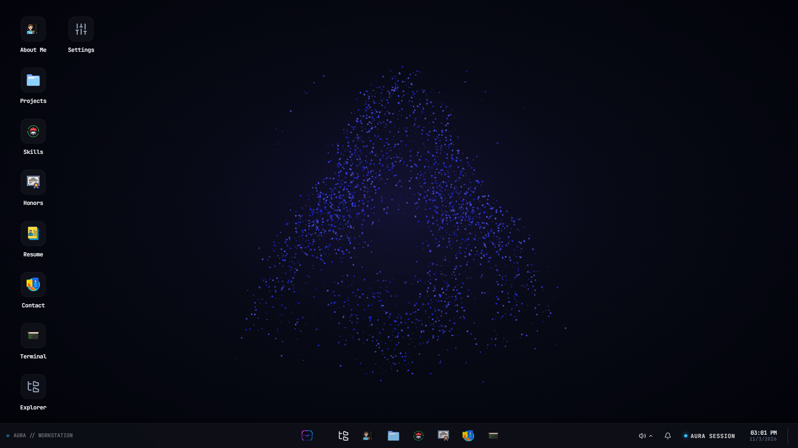
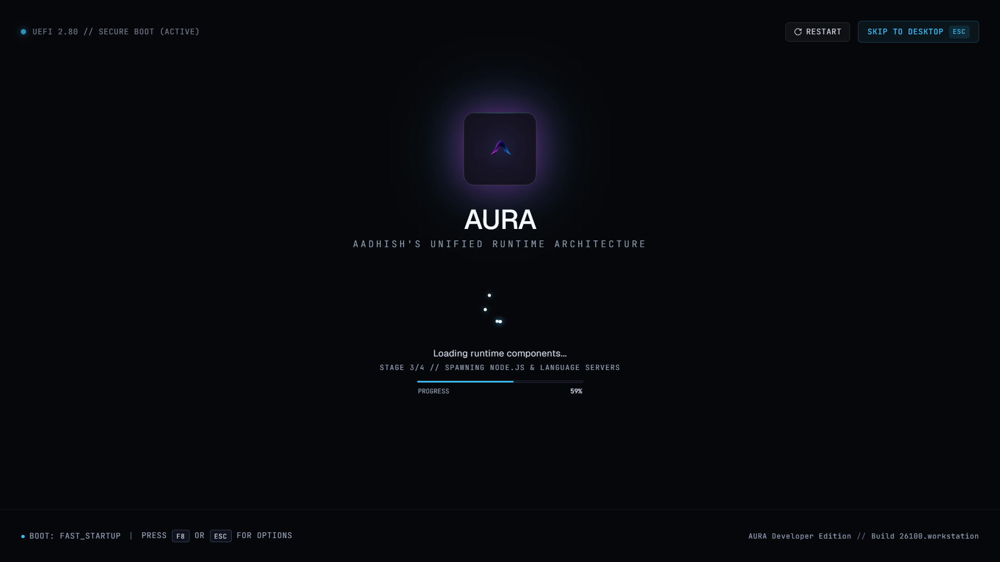
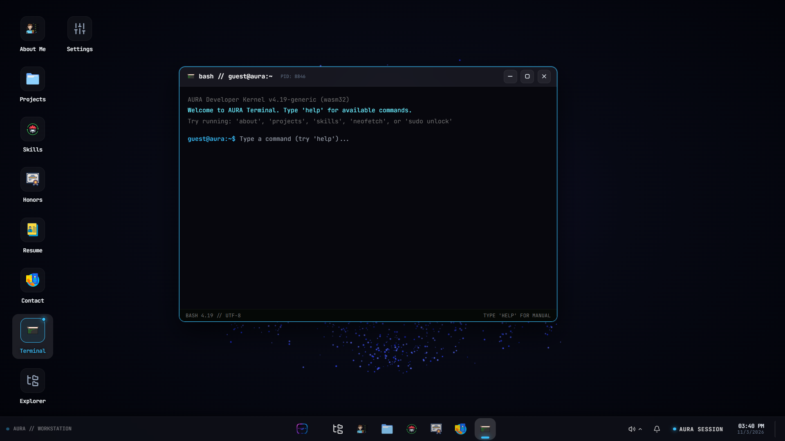
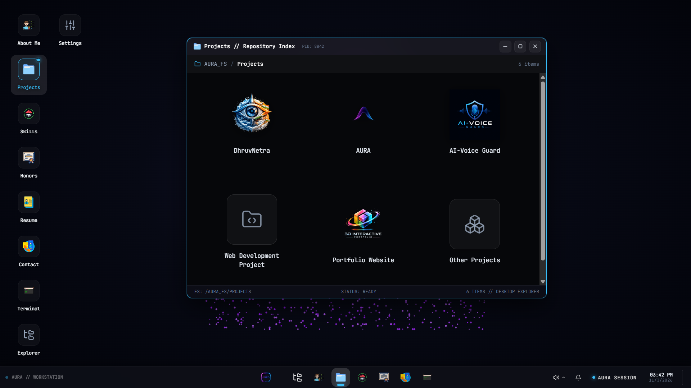
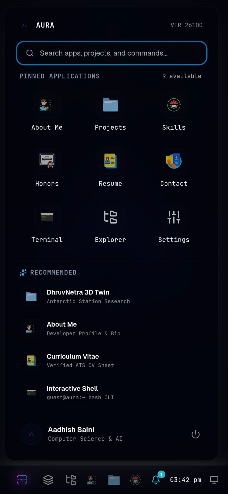

# AURA — Aadhish's Unified Runtime Architecture

> A Browser-Based Interactive Desktop Environment for a Personal Developer Portfolio

[](https://vitejs.dev/)
[](https://react.dev/)
[](https://tailwindcss.com/)
[](https://lucide.dev/)
[](https://aws.amazon.com/amplify/)
[]()

---

## 📸 Project Preview

### Desktop Workstation Environment


<details>
<summary>🔍 <strong>View More Screenshots (Bootloader, Terminal, Applications & Mobile)</strong></summary>

<br>

#### Cinematic UEFI Boot Sequence & Diagnostic Telemetry


#### Interactive Terminal CLI (`guest@aura:~$`)


#### Projects Explorer & Case Studies


#### Responsive Mobile OS Layout (320px – 768px)


</details>

---

## 🖥️ Overview

**AURA (Aadhish's Unified Runtime Architecture)** reimagines the personal developer portfolio as a fully functional, browser-based desktop operating environment.

Traditional developer portfolios follow a predictable formula: a static hero banner, an about section, a grid of project cards, and a contact form. While informative, this linear scrolling pattern rarely creates a lasting impression. 

AURA was engineered from first principles to turn the developer portfolio into an exploratory product:
- Visitors do not just read about projects; they navigate an authentic operating system.
- Applications run in independent floating windows managed by a custom window compositor.
- System diagnostics, boot sequences, and hardware telemetry reinforce the identity of a developer passionate about computer systems and artificial intelligence.
- Terminal commands, discovery puzzles, and tactile OS interactions reward curiosity.

---

## ✨ Features

### Implemented Features

#### 1. Cinematic UEFI Bootloader & Audio Confirmation
- **Multi-Phase Telemetry Pipeline**: Displays kernel initialization, microcode verification, memory mapping, filesystem mounting, and runtime launch logs.
- **Orbital Ring Deceleration**: 5-dot orbital ring loader with velocity physics.
- **Authentic Startup Sound**: Automatically plays `/startup_sound.mp3` once upon desktop entry following user boot interaction, engineered to comply with browser audio autoplay security policies.
- **Diagnostic Controls**: Clickable kernel monogram to soft-reboot; keyboard shortcuts (`ESC` / `F8`) to bypass diagnostics.

#### 2. Original Particle Silhouette Background
- **Interactive Canvas Physics**: Custom particle system rendering the developer silhouette and AURA monogram.
- **Ambient Drift & Proximity Reaction**: Particles subtly drift in real-time and react to cursor coordinates without causing layout reflows or impacting window drag performance.

#### 3. Custom Multi-Window Compositor (No External UI Libraries)
- **Independent Window Management**: Built from scratch using standard React state and native DOM events.
- **Window Controls**: Minimize to taskbar with origin-aware gliding animations, maximize/restore toggle, close, and header dragging.
- **Dynamic Z-Index Elevation**: Clicking any window elevates its stacking depth above other active applications.
- **Boundary Clamping & Edge Snapping**: Prevents windows from being lost beyond viewport borders and docks cleanly above the bottom taskbar.
- **Keyboard Multitasking**: Supports global application switching (`Alt + Tab`) and command palette indexing (`Ctrl + K`).

#### 4. Windows-Style Desktop & Taskbar
- **Grouped Vertical Desktop Icons**: Windows-style left-aligned vertical icon grouping that wraps into adjacent columns with fixed clearance from the Start menu.
- **Centered Taskbar Cluster**: Pinned application shortcuts, active open window pills, live system clock, and system tray.
- **Interactive Start Menu**: Windows 11-inspired launcher featuring quick app launches, developer profile badge, and shutdown/reboot controls.
- **Windows-Style Calendar Popover**: Interactive monthly calendar with date navigation, event markers, and live time updates.

#### 5. High-Contrast Obsidian Dark Theme
- **Dark Mode Lock**: Obsidian black backdrop (`#050811` / `#06070a`) complemented by neon violet (`#a855f7`), sky blue (`#38bdf8`), and emerald accents.
- **Glassmorphism Accents**: Hardware-accelerated backdrop blur filters and high-contrast typographic hierarchy.

#### 6. Multi-Tier Responsive Architecture
- **Desktop & Ultra-wide (>= 1440px)**: Full multi-window compositor, ambient particle canvas, and centered Windows 11 taskbar.
- **Laptops (1024px – 1439px)**: Grouped left-column desktop icon arrangement with zero Start menu overlap.
- **Tablets (768px – 1023px)**: Compact taskbar clustering, touch window resizing, and snappable workspace.
- **Mobile Phones (< 768px down to 320px)**: Distraction-free mobile OS mode with native full-screen card windows, touch-friendly headers, 3-column launcher grid, and touch bottom dock.

#### 7. Interactive Terminal CLI (`guest@aura:~$`)
- **19+ Implemented Commands**: `help`, `about`, `whoami`, `projects`, `skills`, `achievements`, `contact`, `resume`, `open <app>`, `clear`, `date`, `time`, `history`, `neofetch`, `shortcuts`, `notes`, `exit`, `override`, and `hint`.
- **Command History**: Cycle through previously typed commands using `ArrowUp` and `ArrowDown`.
- **Levenshtein Fuzzy Matching**: Automatically detects typos and suggests the closest valid command.
- **Neofetch Telemetry**: ASCII artwork of the AURA monogram accompanied by live system metrics.

#### 8. Hidden Easter Egg & Achievement Engine
- **"SYSTEM OVERRIDE — The Hidden Gem"**: Hidden cybersecurity puzzle game unlocked via terminal (`override`) or discovery hints.
- **Achievement Notification Toasts**: Real-time slide-in toasts triggered upon unlocking milestones (e.g. `WAIT... WHERE'S MY GAME?!`, `project-explorer`).

#### 9. Production Contact Transmission Hub
- **Formspree Integration**: Submits live messages via POST request to the configured Formspree endpoint (`import.meta.env.VITE_FORMSPREE_ENDPOINT`).
- **Robust Client Validation**: Email format verification, required field checking, loading state spinner, duplicate submission lock, and honeypot spam protection.

---

### In Development
- **AWS Amplify CI/CD Integration**: Cloud deployment pipelines, custom domain routing, and automated global CDN edge distribution.

---

### Planned Features
- **Monaco-Inspired Code Editor**: In-browser code editor allowing visitors to inspect, edit, and test code snippets inside AURA.
- **Embedded Interactive Live Demos**: Running sandboxed project demos directly within project detail windows.

---

## 📱 Applications Inside AURA

AURA includes 9 dedicated applications accessible via desktop shortcuts, the Start menu, or the terminal:

| # | Application | App ID | Role / Function |
|---|---|---|---|
| 1 | **About Me** | `about` | 7-chapter editorial story detailing origins, learning methodology, engineering values, and AI vision. |
| 2 | **Projects** | `projects` | Dedicated repository explorer featuring in-depth case studies for **DhruvNetra**, **AURA**, **AI-Voice Guard**, and **Interactive Developer Portfolio**. |
| 3 | **Skills** | `skills` | Interactive proficiency matrix covering Programming Languages, Web Technologies, Artificial Intelligence, Databases, and Developer Tooling. |
| 4 | **Achievements** | `achievements` | Verified academic, competitive, and hackathon honors (including Rank 7 / 63 teams in an internal college hackathon). |
| 5 | **Resume** | `resume` | Native embedded document viewer displaying ATS-formatted curriculum vitae with instant PDF download and external preview. |
| 6 | **Contact** | `contact` | Direct communication console with Formspree email submission, field validation, and social links. |
| 7 | **Terminal** | `terminal` | Bash-style command-line web shell supporting 19+ verified commands, command history, and neofetch telemetry. |
| 8 | **File Explorer** | `explorer` | Hierarchical virtual filesystem (`/AURA_FS`) with breadcrumb navigation and direct file-to-application launching. |
| 9 | **Settings** | `settings` | Workstation preferences, fullscreen mode toggle, and system build telemetry. |

---

## 🛠️ Technology Stack

Every technology in AURA has been verified directly against `package.json`:

| Layer | Technology | Version | Purpose |
|---|---|---|---|
| **Frontend Framework** | [React](https://react.dev/) | `^18.3.1` | Modular application component architecture, state hooks, and window compositor |
| **DOM Renderer** | [React DOM](https://react.dev/) | `^18.3.1` | Virtual DOM rendering and event normalization |
| **Bundler & Tooling** | [Vite](https://vitejs.dev/) | `^6.0.7` | Lightning-fast HMR development server and optimized Rollup production builds |
| **Styling & Design** | [Tailwind CSS](https://tailwindcss.com/) | `^3.4.17` | Utility-first responsive styling, CSS variables, and layout geometry |
| **Post-Processing** | [PostCSS](https://postcss.org/) & [Autoprefixer](https://github.com/postcss/autoprefixer) | `^8.4.49` / `^10.4.20` | CSS parsing, vendor prefixing, and browser compatibility |
| **Iconography** | [Lucide React](https://lucide.dev/) | `^1.16.0` | Crisp SVG vector iconography across desktop, taskbar, and applications |
| **Deployment Target** | [AWS Amplify](https://aws.amazon.com/amplify/) | Cloud | Hosting, CI/CD automated deployments, and global CDN distribution |
| **Contact Service** | [Formspree](https://formspree.io/) | API | Serverless contact transmission endpoint |

---

## 📂 Project Directory Structure

```text
aura/
├── public/
│   ├── icons/                   # Custom high-resolution desktop application icons
│   │   ├── about me.png
│   │   ├── contact.png
│   │   ├── honors.png
│   │   ├── projects.png
│   │   ├── resume.png
│   │   ├── skills.png
│   │   └── terminal.png
│   ├── projects-icons/          # Dedicated project case study icons
│   │   ├── 3d-portfolio-icon.png
│   │   ├── ai-voice-guard-icon.png
│   │   └── dhruvnetra-icon.png
│   ├── AURA-icon.png            # Official AURA system emblem
│   ├── favicon.ico              # Browser tab favicon
│   └── startup_sound.mp3        # Desktop boot confirmation sound
├── src/
│   ├── components/
│   │   ├── applications/        # 9 Core desktop applications
│   │   │   ├── about/           # About Me chapters & narrative
│   │   │   ├── contact/         # Contact form & Formspree integration
│   │   │   ├── honors/          # Verified achievements & honors
│   │   │   ├── override/        # "SYSTEM OVERRIDE" hidden cybersecurity puzzle
│   │   │   ├── projects/        # Dedicated in-depth case study views
│   │   │   │   ├── aivoiceguard/
│   │   │   │   ├── aura/        # AURA 15-section case study (Hero, Sections, Details)
│   │   │   │   ├── dhruvnetra/
│   │   │   │   └── portfolio/
│   │   │   ├── resume/          # Curriculum vitae viewer
│   │   │   ├── skills/          # Hardware/software matrix
│   │   │   ├── AboutApp.jsx
│   │   │   ├── AchievementsApp.jsx
│   │   │   ├── ContactApp.jsx
│   │   │   ├── FileExplorerApp.jsx
│   │   │   ├── ProjectsApp.jsx
│   │   │   ├── ResumeApp.jsx
│   │   │   ├── SettingsApp.jsx
│   │   │   ├── SkillsApp.jsx
│   │   │   ├── SystemOverrideApp.jsx
│   │   │   └── TerminalApp.jsx
│   │   ├── common/              # Reusable UI components & ErrorBoundary
│   │   │   ├── AppIcon.jsx
│   │   │   └── ErrorBoundary.jsx
│   │   ├── desktop/             # Desktop workspace & multi-window compositor
│   │   │   ├── AppWindow.jsx    # Movable window frame & controls
│   │   │   ├── CalendarPopover.jsx
│   │   │   ├── CommandPalette.jsx
│   │   │   ├── Desktop.jsx      # Main desktop orchestrator
│   │   │   ├── DesktopIconGrid.jsx
│   │   │   ├── NotificationCenter.jsx
│   │   │   ├── SnapPreview.jsx
│   │   │   ├── StartMenu.jsx
│   │   │   ├── Taskbar.jsx
│   │   │   └── TaskbarCalendar.jsx
│   │   ├── launcher/            # Workspace entry gate & launcher
│   │   │   └── SystemLauncher.jsx
│   │   ├── power/               # Power menu & sleep overlays
│   │   │   ├── PowerMenu.jsx
│   │   │   └── SleepScreen.jsx
│   │   ├── shutdown/            # System shutdown animation
│   │   │   └── ShutdownScreen.jsx
│   │   ├── BootProgress.jsx     # Telemetry progress bar
│   │   ├── BootScreen.jsx       # Root UEFI boot container
│   │   ├── BootStatus.jsx       # Diagnostics text logs
│   │   ├── BrandLogo.jsx        # Kernel geometric monogram
│   │   ├── OrbitalLoader.jsx    # 5-dot orbital ring loader
│   │   ├── SystemFooter.jsx     # Diagnostic watermark bar
│   │   └── SystemHeader.jsx     # Diagnostic header bar
│   ├── config/                  # Configuration & data registries
│   │   ├── desktopApps.js       # Desktop app geometry, registry & routing
│   │   ├── portfolioData.js     # Global developer profile data
│   │   └── terminalCommands.js  # 19+ CLI command definitions & neofetch output
│   ├── hooks/                   # Custom React hooks
│   │   ├── useBootSequence.js   # Multi-phase boot sequence state machine
│   │   ├── useFullscreen.js     # Fullscreen toggle API hook
│   │   ├── useTheme.js          # Theme provider hook
│   │   └── useWindowManager.js  # Window compositor, stacking & focus manager
│   ├── styles/                  # Application stylesheets
│   │   ├── boot-screen.css      # Bootloader keyframe animations
│   │   ├── desktop.css          # Window compositor & glassmorphism filters
│   │   ├── global.css           # Tailwind directives & CSS reset
│   │   └── themes.css           # Obsidian dark CSS custom properties
│   ├── utils/                   # Helper utilities
│   │   ├── achievementManager.js # Achievement unlock engine & toast dispatcher
│   │   ├── easterEggManager.js  # Discovery hints & puzzle state
│   │   ├── notificationManager.js
│   │   ├── startupSound.js      # Startup audio gesture unlocking
│   │   ├── windowAnimations.js  # Minimize & restore gliding physics
│   │   └── windowSnap.js        # Window snapping calculations
│   ├── App.jsx                  # Root state coordinator
│   └── main.jsx                 # Application entry point
├── .gitignore                   # Production git ignore rules
├── index.html                   # HTML entry point with system metadata
├── package.json                 # Project configuration & dependencies
├── postcss.config.js            # PostCSS configuration
├── tailwind.config.js           # Tailwind design tokens & breakpoints
└── vite.config.js               # Vite build configuration
```

---

## 🚀 Getting Started

### Prerequisites
- **Node.js**: `v18.0.0` or higher
- **npm**: `v9.0.0` or higher

### Installation

1. Clone the repository:
   ```bash
   git clone https://github.com/aadhish-saini/aura.git
   cd aura
   ```

2. Install dependencies:
   ```bash
   npm install
   ```

3. Configure environment variables:
   Create a `.env` file in the root directory (optional for Formspree contact form):
   ```env
   VITE_FORMSPREE_ENDPOINT=https://formspree.io/f/mkjjqzpk
   ```

### Running Locally

Start the Vite development server:
```bash
npm run dev
```
Open your browser and navigate to the local URL displayed in your terminal (typically `http://localhost:5173` or `http://localhost:3000`).

### Production Build

Compile the optimized production bundle:
```bash
npm run build
```
The output will be generated inside the `dist/` directory.

Preview the production build locally:
```bash
npm run preview
```

---

## ☁️ Deployment (AWS Amplify)

AURA is configured for seamless static cloud deployment via **AWS Amplify Hosting**:

1. Connect your GitHub repository to AWS Amplify Console.
2. Configure the build settings in `amplify.yml`:
   ```yaml
   version: 1
   frontend:
     phases:
       preBuild:
         commands:
           - npm ci
       build:
         commands:
           - npm run build
     artifacts:
       baseDirectory: dist
       files:
         - '**/*'
     cache:
       paths:
         - node_modules/**/*
   ```
3. Set environment variables (such as `VITE_FORMSPREE_ENDPOINT`) in the Amplify Console under **App Settings > Environment variables**.
4. Deploy the application. Continuous deployment will automatically build and publish updates pushed to your default branch.

---

## 📈 Development Journey

AURA was engineered through a disciplined seven-phase development approach:

1. **Phase 1 — Concept & Brand Identity**: Defined the AURA identity, Obsidian dark visual language, particle silhouette aesthetic, and the OS portfolio concept.
2. **Phase 2 — UEFI Bootloader & Particle Canvas**: Built the multi-phase boot sequence, diagnostic telemetry logging, orbital progress ring, and background particle canvas.
3. **Phase 3 — Window Compositor & Taskbar**: Implemented the independent multi-window manager, draggable window frame, Windows 11-inspired taskbar, and Start launcher.
4. **Phase 4 — Portfolio Applications**: Developed all 9 dedicated applications, integrating editorial bio chapters, skill matrices, curriculum vitae viewer, and contact form.
5. **Phase 5 — Terminal CLI & Discovery Engine**: Built the Bash-style web shell with 19+ commands, fuzzy suggestions, neofetch, and the hidden "SYSTEM OVERRIDE" cybersecurity Easter egg.
6. **Phase 6 — Multi-Tier Responsive Adaptation**: Optimized the desktop experience across mobile phones (down to 320px), tablets, laptops, and ultra-wide displays.
7. **Phase 7 — Deep Case Studies & Production Polish**: Added in-depth technical case studies for featured projects (DhruvNetra, AURA, AI-Voice Guard, and 3D Portfolio), cleaned up assets, and refined the codebase for production.

---

## 🗺️ Roadmap

| Milestone | Category | Status |
|---|---|---|
| Core Operating System Architecture | Architecture | ✅ Completed |
| Multi-Window Compositor & Taskbar | Desktop | ✅ Completed |
| 9 Dedicated Portfolio Applications | Content | ✅ Completed |
| Interactive Terminal CLI (19+ commands) | Command Line | ✅ Completed |
| Hidden Cybersecurity Puzzle & Achievements | Easter Egg | ✅ Completed |
| Multi-Tier Responsive Experience (320px – 4K) | Responsive Design | ✅ Completed |
| In-Depth Project Case Studies (DhruvNetra, AURA, AI-Voice Guard, 3D Portfolio) | Showcase | ✅ Completed |
| AWS Amplify Cloud Deployment & CI/CD Pipeline | Infrastructure | 🔄 In Development |
| Embedded Interactive Project Live Demos | Features | 📋 Planned |
| In-Browser Code Sandbox / Editor | Features | 📋 Planned |

---

## 👨‍💻 Author

**Aadhish Saini**  
- **GitHub**: [@aadhish-saini](https://github.com/aadhish-saini)  
- **Role**: Software Developer & AI Systems Enthusiast  
- **Focus**: Artificial Intelligence, Interactive Frontend Systems & Web Architecture  

> *"Not just a portfolio. A workspace built around my journey."*

---

## 📄 License

No license is currently specified for this project. All rights are reserved by the author ([Aadhish Saini](https://github.com/aadhish-saini)).
